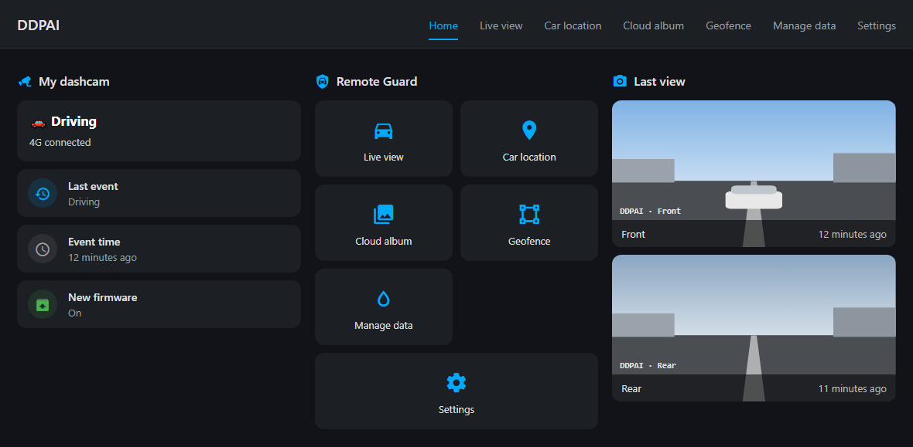
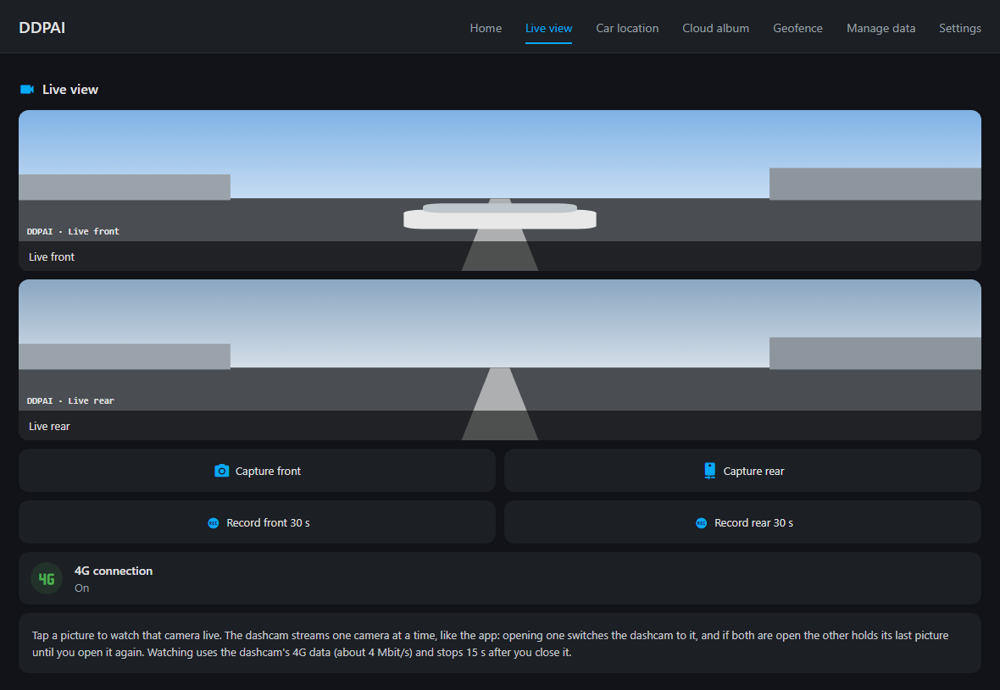
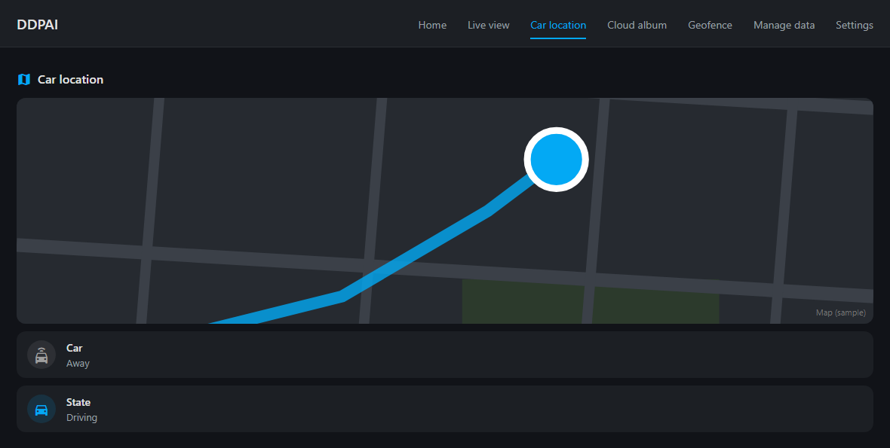
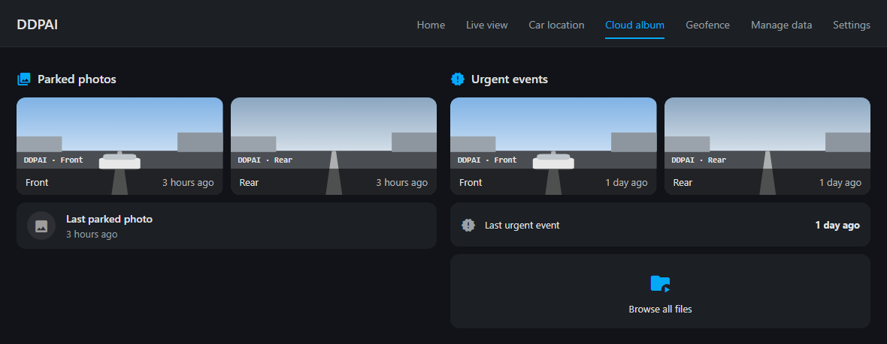
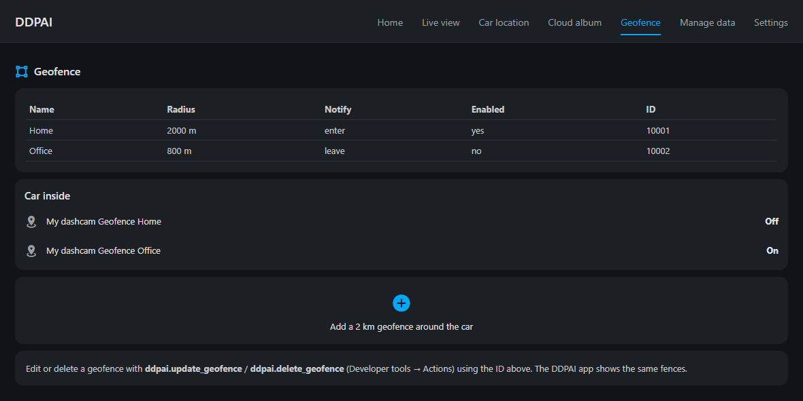
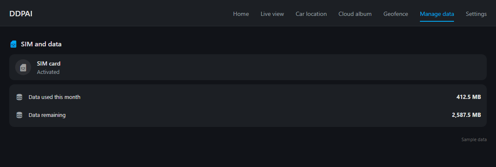
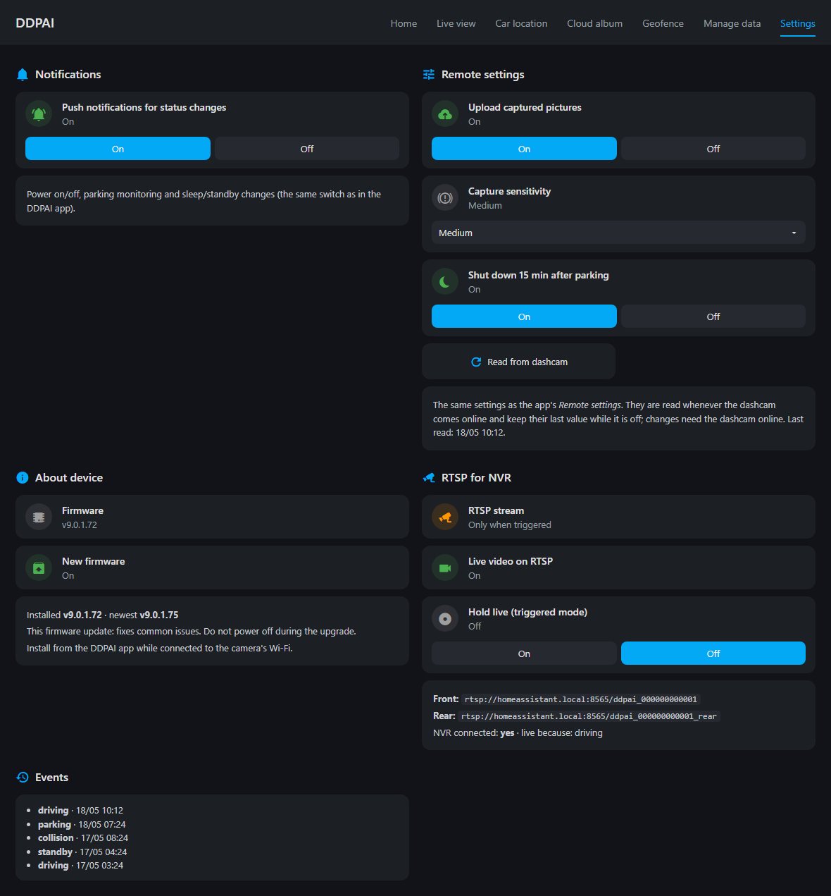

# DDPAI Dashcam for Home Assistant

Unofficial Home Assistant integration for **DDPAI 4G dashcams** (for example the Z60 / Z60 Pro
with a 4G cloud box, Z50 Pro, X5 Pro 4G), using the same cloud account as the DDPAI app.

Live view of both cameras over 4G, RTSP for an NVR, the car's position, the cloud album,
geofences, the app's remote settings and more — with a ready-made dashboard laid out like the app.

Not affiliated with or endorsed by DDPAI.

## What you get

For every camera on the account that has a 4G link:

| Entity | What it shows |
|---|---|
| `camera.<camera>_live_front` / `_live_rear` | 4G live view of each lens (see [Live view](#live-view)) |
| `button.<camera>_capture_front` / `_rear` | Take a picture now (saved to *Media → ddpai*) |
| `image.<camera>_last_view_front` / `_rear` | Newest picture of each lens: the last live view or the newest parked photo |
| `device_tracker.<camera>` | Last position the camera reported |
| `sensor.<camera>_state` | `driving`, `standby`, `parking`, `offline` |
| `binary_sensor.<camera>_4g_link` | Whether the camera is online over 4G |
| `sensor.<camera>_last_event` / `_last_event_time` | Last power / collision / state change (recent list in attributes) |
| `sensor.<camera>_last_parked_photo` | When the newest parked photo reached the cloud |
| `image.<camera>_parked_photo_<lens>` | Newest parked photo of each lens |
| `image.<camera>_urgent_event_<lens>`, `sensor.<camera>_last_urgent_event` | Newest urgent (collision) clip — appear with the first urgent clip |
| `switch.<camera>_upload_captured_pictures`, `select.<camera>_capture_sensitivity` / `_parking_capture_sensitivity`, `switch.<camera>_shut_down_15_min_after_parking` | The app's *Remote settings* (see [Remote settings](#remote-settings)) |
| `switch.<camera>_status_change_notifications` | The app's push notifications for power / parking / standby changes |
| `sensor.<camera>_firmware`, `binary_sensor.<camera>_firmware_update_available` | Installed firmware; newest version and release notes in the attributes |
| `sensor.<camera>_geofences`, `binary_sensor.<camera>_geofence_<name>` | Geofences, and whether the car is inside each one |
| `sensor.<camera>_sim_card` | SIM state; data plan sensors appear only for a SIM with a DDPAI data plan |
| `select.<camera>_rtsp_stream`, `switch.<camera>_rtsp_live`, `binary_sensor.<camera>_rtsp_live_video` | RTSP output for an NVR (see [RTSP for NVRs](#rtsp-for-nvrs)) |

Pictures for the cabin camera (MINI2X) and urgent clips are created only once such a file exists,
so there are no entities stuck on *unavailable*.

The **media browser** gets a *DDPAI Dashcam* folder with the cloud album — *Parked photos* and
*Urgent events*, per camera, with thumbnails, streamed through Home Assistant (the DDPAI media
server is plain HTTP).

Events for automations:

- `ddpai_device_event` — `device_uuid`, `device_name`, `event` (e.g. `collision`, `driving`,
  `parking`, `offline`), `time`
- `ddpai_new_media` — `device_uuid`, `device_name`, `album`, `camera`, `kind`, `item_id`, `time`
- `ddpai_capture` — `device_uuid`, `lens`, `path` (after a Capture button)

## Dashboard

[`examples/dashboard.yaml`](examples/dashboard.yaml) is a complete dashboard laid out like the
DDPAI app: **Home** (status and the *Remote Guard* tiles), **Live view** (both cameras, Capture,
Record 30 s), **Car location**, **Cloud album**, **Geofence**, **Manage data** and **Settings**
(notifications, remote settings, firmware, RTSP, events).

1. **Settings → Dashboards → Add dashboard → New dashboard from scratch**, URL `ddpai-dashboard`.
2. Open it, **✎ → ⋮ → Raw configuration editor**, paste the file.
3. Replace `my_dashcam` with your camera's entity prefix and `YOUR_DDPAI_DEVICE_ID` with its device
   id (both explained at the top of the file).

A few cards use [auto-entities](https://github.com/thomasloven/lovelace-auto-entities) (HACS) to show
only the pictures and sensors your camera has.

> The pictures below are rendered from `examples/dashboard.yaml` itself by
> [`examples/render_screenshots.py`](examples/render_screenshots.py), with invented placeholder
> readings and drawn camera pictures — no real location, plate or account data.

### Home

The camera's state and 4G link, the last event, firmware, the app's *Remote Guard* tiles, and the
newest picture from each camera.

### Live view

One card per camera: it shows the last picture, and tapping it plays live video. Capture saves a
picture, Record saves 30 seconds.

### Car location

Where the car is now and its recent track.

### Cloud album

The newest parked photos and urgent clips from each camera, and a way into the whole album.

### Geofence

The fences shared with the app, whether the car is inside each one, and a one-tap fence around
the car.

### Manage data

The SIM, and the data plan when the SIM has a DDPAI plan.

### Settings

Status notifications, the app's remote settings, firmware, the RTSP output and the recent events.

## Live view

`Live front` and `Live rear` stream the camera's picture over its 4G link, the way the app's
*Live view* does: a ThroughTek (TUTK) Kalay P2P session, played by Home Assistant's go2rtc as
WebRTC. Tap a camera card to watch.

- A session starts when somebody opens a camera and stops 15 seconds after the last viewer
  leaves — watching uses the camera's 4G data (about 4 Mbit/s) and keeps it awake.
- **One lens at a time.** The dashcam has a single live encoder, like in the app. Opening
  `Live rear` switches the dashcam to the rear lens; with both cameras open, the one opened last
  has the dashcam and the other holds its last picture (it never shows the other lens).
- Front streams at 1280×720, rear at 848×480 (Z60 Pro), H.264 about 30 fps.
- If the camera is in standby it is woken first; a switched-off camera answers "offline" (the
  reason is in the camera's `last_error` attribute).
- The P2P part needs ThroughTek's native library (`libIOTCAPIs_ALL.so`, x86-64 or ARM64). It is
  downloaded on first use from the public wyze-bridge image (or reused from the CuboAI
  integration). Home Assistant OS runs on musl, so the integration loads an adapted copy of this
  glibc build; nothing has to be installed. It runs in a separate process, so a crash in the
  native library cannot take Home Assistant down.
- The library needs the TUTK SDK **license key** of the DDPAI app, which is not shipped here.
  Enter it under **Configure → General**.

**Capture** opens the chosen lens briefly and saves its first full picture to *Media → ddpai*
(it also becomes that lens's *Last view*). **Record** in the example dashboard uses Home
Assistant's own `camera.record` to save 30 seconds to the same folder.

## Remote settings

The settings on the app's *Remote settings* page:

| Entity | Setting |
|---|---|
| `switch.<camera>_upload_captured_pictures` | Upload captured pictures to the cloud album |
| `select.<camera>_capture_sensitivity` | Collision capture sensitivity while driving: high, medium, low, off |
| `select.<camera>_parking_capture_sensitivity` | The same while parked |
| `switch.<camera>_shut_down_15_min_after_parking` | Shut down 15 minutes after parking |

They are read from the camera whenever it comes online (and with the *Read remote settings* button
or the `ddpai.read_settings` action, which returns every setting the camera reports) and keep
their last value while the car is off. Changing one needs the camera online.

## RTSP for NVRs

The dashcam can be recorded by an NVR (HiLook/Hikvision, Frigate, Blue Iris, Synology Surveillance
Station…) as an ordinary RTSP camera — the same design as the Proof Plus integration. Choose the mode
under **Configure → RTSP / NVR** or with the **RTSP stream** select:

| Mode | What the NVR gets |
|---|---|
| **Off** (default) | No RTSP server. |
| **Only when triggered** | Live video while a trigger is active, and a still **standby picture** the rest of the time. |
| **Always** | Live video whenever the NVR is connected. |

Give the NVR `rtsp://<home-assistant-ip>:8565/ddpai_<id>` for the front camera and `…_rear` for the
rear one — the exact addresses are on the **RTSP / NVR** options page and in the `url` / `rear_url`
attributes of `binary_sensor.<camera>_rtsp_live_video`. Port 8565 (not Proof's 8564), so both
integrations can feed one NVR from the same box. Video only, H.264, passed through exactly as the
dashcam encodes it.

**Triggers** (only in *only when triggered*):

- **Events** — the device events you pick (collision, parking collision and a new urgent clip by
  default) start live video for 5 minutes; another one extends it. Events arrive with the poll, so
  live video starts up to one poll interval after the event.
- **While driving** — from the camera reporting *driving* until it stops, plus 2 minutes.
- **The `RTSP live` switch** — holds live video on until you switch it off.
- **The `ddpai.rtsp_trigger` action** — live video for a number of minutes, from any automation;
  `ddpai.rtsp_stop` ends every trigger at once.

**The standby picture** is the last live view from that camera (or its newest parked photo), dimmed
and labelled, at that camera's live size. It keeps the NVR connected between triggers and never
changes while shown, so the jump to live video is what the NVR's motion detection records.

**Both cameras.** With *Cameras on the stream* set to **both**, each camera has its own address and
NVR channel, and while live the dashcam switches between them every 15 seconds (configurable): each
channel shows live video on its turn and its last picture, marked *Paused*, in between. Somebody
watching a live camera in Home Assistant keeps the lens they chose.

**Mobile data.** Live video runs over the dashcam's 4G at about 4 Mbit/s — roughly 1.8 GB an hour.
*Always* means that for as long as the NVR is connected. go2rtc only pulls the stream while an RTSP
client is connected, so with no NVR connected nothing reaches the dashcam.

## Geofences

The geofences are the same ones the DDPAI app shows under *Geofence*, so the app keeps sending its
enter/leave notifications. Manage them from Home Assistant with three actions:

- `ddpai.add_geofence` — `device_id`, `name`, optional `latitude`/`longitude` (default: the car's
  last position), `radius` in metres (default 2000), `notify_on` (`enter` or `leave`), `enabled`
- `ddpai.update_geofence` — `device_id`, `geofence_id`, and any field to change (e.g.
  `enabled: false` to switch a fence off)
- `ddpai.delete_geofence` — `device_id`, `geofence_id`

Each action returns the camera's updated geofence list. The `geofence_id` is in the attributes of
`sensor.<camera>_geofences`. Fences made in the app appear within 5 minutes.

## Setup

1. Copy `custom_components/ddpai` into your Home Assistant `config/custom_components/`
   (or add this repository to HACS as a custom repository) and restart Home Assistant.
2. **Settings → Devices & services → Add integration → DDPAI Dashcam.**
3. Sign in with the email (or phone) and password you use in the DDPAI app, and pick your country.
4. For live view, RTSP and the remote settings, enter the TUTK SDK license key under
   **Configure → General**.

The password is stored in the config entry: the DDPAI cloud ends a session after 30 minutes
without use, and the integration signs in again when that happens. If you change the password,
Home Assistant asks for the new one.

## Options

**General**

- **Poll interval** — how often state and position are read (default 60 s, minimum 30 s).
- **Media browser** — show the cloud album in the media browser (default on).
- **4G live view cameras** — add the live camera entities (default on).
- **Take parked photos ourselves** — when the car stops, capture both cameras (a few seconds of
  4G data) and show those as the *Parked photo* pictures. Off (default): only the photos the camera
  uploads to the cloud album, which it does only now and then.
- **TUTK SDK license key** — needed for live view, RTSP, Capture and the remote settings. Leaving
  the field blank keeps the stored key.

**RTSP / NVR** — mode, cameras on the stream, switch interval, trigger events, driving trigger,
port and an optional RTSP login (see [RTSP for NVRs](#rtsp-for-nvrs)).

## Good to know

- The cloud's event list stays empty for many cameras (the app's status notifications are phone
  pushes). The integration therefore records the state changes it sees itself — driving, standby,
  parking, offline — and keeps them across restarts.
- The cloud sends the last known position but no time of fix; the tracker's
  `position_changed` attribute records when Home Assistant saw the position move.
- Reading the cloud album marks it as read in the DDPAI app. The integration only lists the
  album when the unread counter says something new arrived (and every 30 minutes), but new
  items may not show the app's "new" badge.
- Firmware cannot be installed from Home Assistant: the app installs it over the camera's own
  Wi-Fi. The firmware sensors only tell you when a new version is out.
- Not supported: talking through the dashcam (*call*), the 4G self-test and the on-camera album —
  the app does those over the camera's local Wi-Fi.
